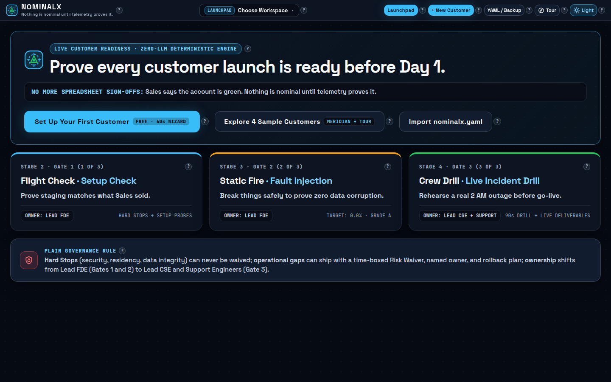
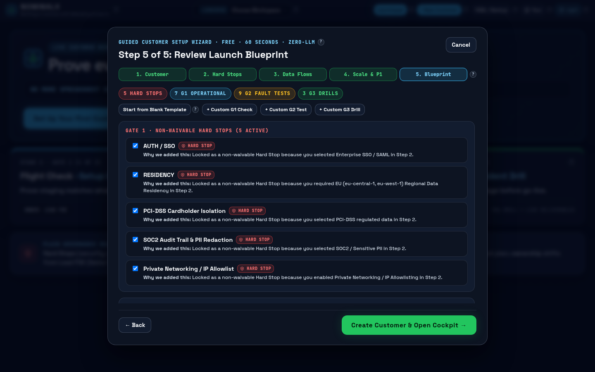
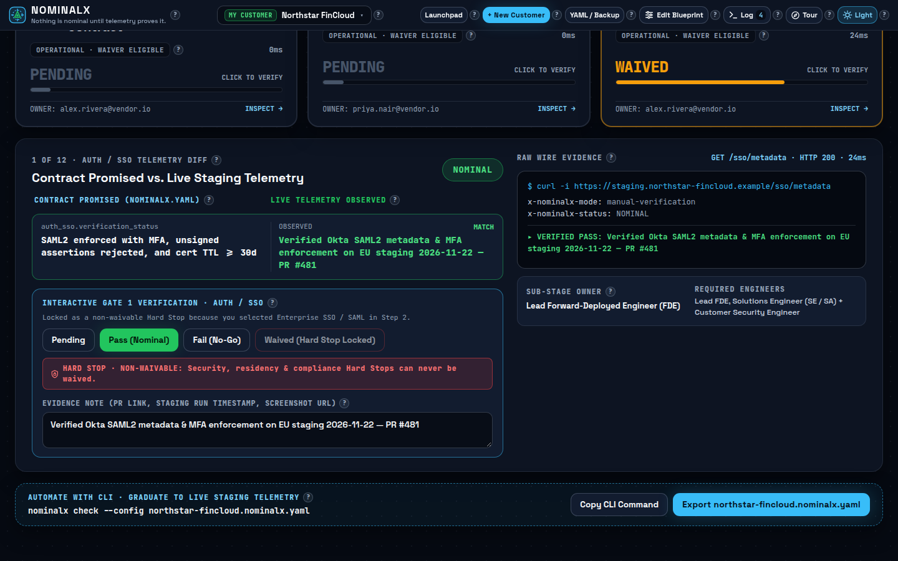
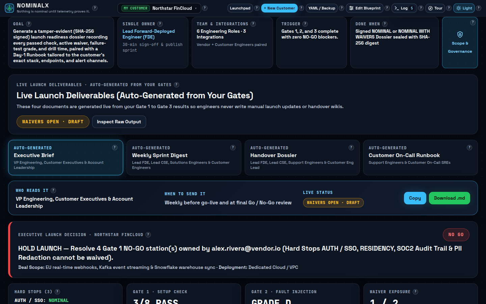
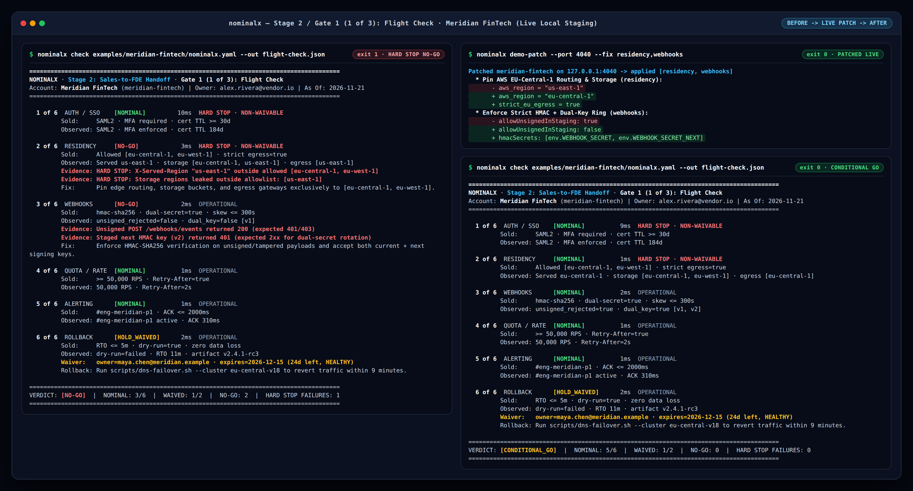
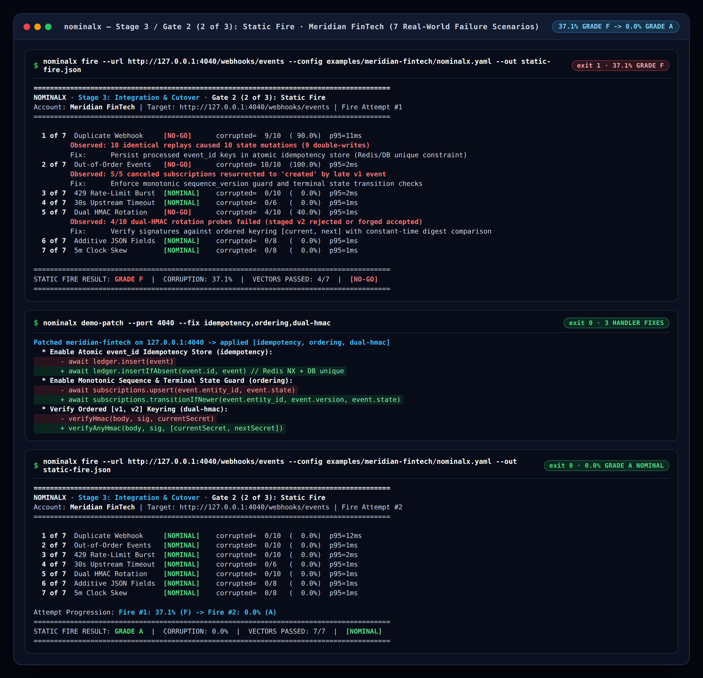
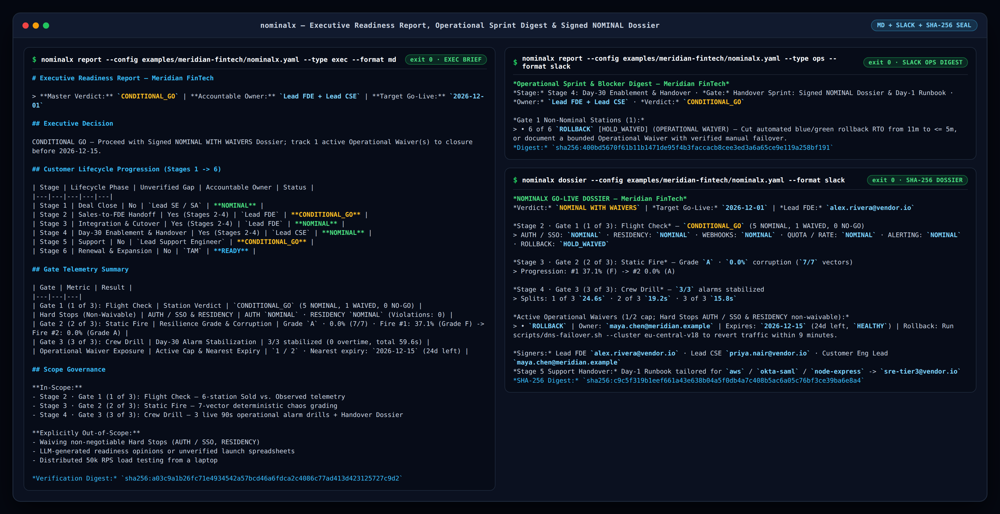

# NominalX — Field Guide & Executable Flight-Readiness System

> ***"Sales says the account is green. Nothing is nominal until telemetry proves it."***


**Live Mission Control Cockpit (Vercel, auto-deployed from `main`):** [https://nominalx.vercel.app](https://nominalx.vercel.app)

---

## An Open Guide, Ideas & Inspiration for Customer-Facing Engineering Teams

NominalX is an open field guide, working set of ideas, and executable reference architecture built engineer-to-engineer for technical products deployed into technical customer environments. Fork it, adapt its sprint contracts, or borrow its Hard Stop and reporting patterns to replace 90-row launch spreadsheets and Day-30 slide decks with deterministic telemetry.

NominalX is the result of sitting down with busy minds who run strategic enterprise deployments in the real world. It is the simplest way to get a real glimpse into their experience, how they think, and the critical details they normally keep in their heads or try to wrangle inside Google Sheets, Monday.com, or Linear. Complex? Detailed? Verbose? Yes — because real strategic deployments are, and this reflects that reality instead of hiding it behind a green slide.

**Written explicitly for:**
- **Customer-Facing Engineers:** **Sales Engineers**, **Solutions Engineers (SEs) / Solutions Architects (SAs)**, **Forward-Deployed Engineers (FDEs) / Implementation Engineers**, **Customer Success Engineers (CSEs)**, **Technical Account Managers (TAMs)**, and **Support Engineers**.
- **Customer Engineers:** **Customer Backend Engineers**, **Customer Platform / Infrastructure Engineers**, **Customer Security Engineers**, and **Customer On-Call SREs**.

### Why Stages 2 → 4 (*The Unverified Gap*)

Most customer software lives at the two edges of the lifecycle: pre-sales CRM at **Stage 1: Deal Close**, or reactive ticketing at **Stage 5: Support**. Almost nothing to be proud of, no proven methodology, and no executable tooling sits in **Stages 2 to 4** — where signed technical commitments actually turn into resilient production systems:

1. **Stage 2: Sales-to-FDE Handoff · Gate 1 (`1 of 3`): `Flight Check · Setup Check`** — Proves staging matches what Sales sold across parallel telemetry stations (`1 of 6`–`6 of 6`, plus any custom stations) with **Non-Waivable Hard Stops** on `AUTH / SSO`, `RESIDENCY`, and any compliance check marked `hard_stop: true`.
2. **Stage 3: Integration & Cutover · Gate 2 (`2 of 3`): `Static Fire · Fault Injection`** — Breaks things safely before live traffic hits by running **7 realistic failure scenarios** (`1 of 7`–`7 of 7`, plus custom vectors) against staging — duplicate webhooks, out-of-order events, rate-limit bursts, 30-second timeouts, secret rotation, unexpected JSON fields, and clock drift — fixing where it breaks until zero records are lost or corrupted (**`0.0%` corruption, Grade `A`**).
3. **Stage 4: Day-30 Enablement & Handover · Gate 3 (`3 of 3`): `Crew Drill · Live Incident Drill` + Handover Sprint** — Rehearses a real 2 AM outage before go-live via **3 live 90-second Day-30 alarms** (`1 of 3`–`3 of 3`) where Support Engineers and Customer SREs apply real configuration fixes (zero multiple-choice quizzes), then auto-generates a **tamper-evident (SHA-256 signed) Handover Dossier** and **Customer On-Call Runbook** for **Stage 5: Support**.

---

## Free Browser Workspace & First-Run Experience (`https://nominalx.vercel.app`)

Open **[https://nominalx.vercel.app](https://nominalx.vercel.app)** to run NominalX with zero backend, zero sign-up, and zero LLM guesswork (Dark mode default with 1-click Light toggle, Option C big bold blocks, and thorough `?` contextual help tooltips across every screen and control):

- **First-Run Launchpad & Smart Returning-Visitor Routing:** Brand-new visitors (zero customers saved in `My Customers`) land on a clean, 20-second **First-Run Launchpad** explaining all three gates, the plain governance rule (Hard Stops vs. time-boxed Risk Waivers vs. Lead FDE → Lead CSE ownership transfer), and three clear entry actions: **Set Up Your First Customer**, **Explore 4 Sample Customers**, or **Import `nominalx.yaml`**. Returning visitors who have created at least one customer open straight into their most recently active customer automatically, while **`Launchpad`** and **`+ New Customer`** remain always visible in the top mission bar.



- **Universal B2B Technical Customer Setup Wizard (60 Seconds, Zero-LLM):** Works for any B2B technical product (Multi-tenant SaaS, Dedicated Cloud/VPC, Self-Hosted/On-Prem, APIs, Webhooks, Batch/File Imports, Event Streaming, Database/Warehouse Sync, Installed Agents/SDKs). Five plain-language steps deterministically generate Gate 1 Hard Stops (with live lock pills), Gate 1 operational checks, Gate 2 fault-injection tests, and Gate 3 live incident drills — every item showing a one-line **"Why we added this"** rationale tied directly to your answers, with toggles, Hard Stop locks, custom item adders, and a **Start from Blank Template** option.



- **`My Customers` vs. `Sample Accounts` Workspace Switcher:** Cleanly splits your real saved browser launches (`My Customers`, with `+ Add Customer`, `Edit`, `Copy`/duplicate, `Del`/delete, and an empty-state guide) from four pre-built enterprise sandboxes (`Sample Accounts`: Meridian FinTech, Kestrel Health, Vanguard Retail, Helios Logistics — clearly badged `SAMPLE`). **`Reset Scenario`** is scoped strictly to `Sample Accounts` so it never wipes your saved `My Customers`.
- **Interactive Manual Gate Checking, Evidence Notes & CLI Graduation:** On any customer in `My Customers`, engineers can set live statuses (`Pending`, `Pass`, `Fail`, `Waived`) across Gate 1, Gate 2, and Gate 3 right inside the cockpit. The exact `@nominalx/core` governance rules apply — **Hard Stops can never be waived**, and operational waivers enforce a named owner, `≤ 30d` expiry, concrete rollback plan, and max 2 active waivers. Attach per-check **Evidence Notes** (PR links, staging run timestamps, screenshot URLs) saved in `localStorage`, watch Readiness Index and Live Launch Deliverables update live, and graduate to automated staging probes anytime with the inline CLI snippet (`nominalx check --config <slug>.nominalx.yaml`).



- **Portable Export & Import (`nominalx.yaml` + Workspace `.json`):** Export any customer as a clean, CLI-compatible `<slug>.nominalx.yaml` contract file, export your entire `My Customers` browser workspace as a portable `.json` backup, or import `.yaml`/`.json` files via upload or paste-in text with detailed schema validation errors.
- **21-Step Interactive Walkthrough Tour & Contextual `?` Tooltips:** Click **Explore 4 Sample Customers** on the Launchpad or **`Tour`** in the top bar anytime to run a zero-overlap 21-step guided walkthrough framing **Live Customer Readiness** (sprint accountability like Jira/Linear/Monday, backed by real staging telemetry instead of manual green checkboxes). Hover or click any **`?`** icon anywhere in the cockpit for plain-operational guidance.

---

## Master Lifecycle & Sprint Governance Table (Stages 1 → 6)

Every stage is executed as a **time-boxed engineering sprint** with **one Single Accountable Owner**, paired vendor + customer engineers, connected integrations, strict scope boundaries, and telemetry-backed Definition of Done.

| Stage | Goal | Single Accountable Owner | Vendor & Customer Engineers | Connected Integrations | Strict Scope Guardrails (In / Out / Hard Stops) | Reporting & Definition of Done |
|---|---|---|---|---|---|---|
| **Stage 1: Deal Close** *(Pre-Gap Contract Seed)* | Codify signed technical promises into a schema-valid `nominalx.yaml`. | **Lead Solutions Engineer (SE / SA)** | **Vendor:** Sales Eng, SE/SA, Lead FDE (read-in)<br>**Customer:** Eng Lead, Security Eng | CRM Handoff (`nominalx.yaml`), Jira/Linear | **In:** SSO, residency, HMAC, RPS, P1, RTO targets.<br>**Out:** Commercial pricing, unverified verbal promises.<br>**Hard Stop:** Schema-valid `nominalx.yaml` v1.0 required before Gate 1. | Committed `nominalx.yaml` passing `NominalXConfigSchema` with named engineering owners. |
| **Stage 2: Sales-to-FDE Handoff**<br>**Gate 1 (`1 of 3`): `Flight Check · Setup Check`** *(Sprint 1)* | Prove staging matches what Sales sold across parallel stations (`1 of 6`–`6 of 6` + custom stations). | **Lead Forward-Deployed Engineer (FDE)** | **Vendor:** Lead FDE, SE/SA, Sales Eng, Lead CSE, Support Eng, TAM<br>**Customer:** Platform/Infra, Security, Backend, On-Call SRE | Okta/Entra SSO, AWS/GCP Residency, HMAC Gateway, API Quota Edge, PagerDuty/Slack P1, Terraform/ArgoCD Rollback, Jira/Linear | **In:** Live HTTP/header/HMAC probes, strict Sold vs. Observed diffs.<br>**Out:** Waiving Hard Stops, 50k RPS laptop load tests, spreadsheet sign-offs.<br>**Hard Stops:** **`AUTH / SSO` (`1 of 6`), `RESIDENCY` (`2 of 6`), and any `hard_stop: true` custom check are Non-Waivable.** Operational stations allow max **2 active waivers ≤ 30d**. | `flight-check.json`, Live Launch Deliverables; **0 `NO-GO`** stations; all Hard Stops `NOMINAL`. |
| **Stage 3: Integration & Cutover**<br>**Gate 2 (`2 of 3`): `Static Fire · Fault Injection`** *(Sprint 2)* | Break things safely across **7 realistic failure scenarios** (`1 of 7`–`7 of 7` + custom vectors), fix where it breaks, and re-run until zero records are lost or corrupted (`0.0%`). | **Lead Forward-Deployed Engineer (FDE)** | **Vendor:** Lead FDE, TAM<br>**Customer:** Backend, Platform/Infra, Security Engineers | HMAC Webhook Gateway, Rate-Limit Gateway, Release Automation | **In:** Automated failure scenarios, live config diffs, before/after test history.<br>**Out:** Untested prod deploys, LLM-guessed grades, multi-hour soak tests.<br>**Hard Stop:** Any corruption `> 0.0%` locks Gate 2 in `NO-GO` (exit `1`). | `static-fire.json` with **`0.0%` corruption (`Grade A · NOMINAL`)**, all active scenarios passed, before/after delta log. |
| **Stage 4: Day-30 Enablement & Handover**<br>**Gate 3 (`3 of 3`): `Crew Drill · Live Incident Drill` + Handover Sprint** *(Sprint 3)* | Rehearse a real 2 AM outage across **3 live 90s Day-30 alarms** (`1 of 3`–`3 of 3`), then generate a tamper-evident (SHA-256 signed) Handover Dossier & Customer On-Call Runbook. | **Lead Customer Success Engineer (CSE)** *(Crew Drill)*<br>**Lead FDE** *(Handover Sign-Off)* | **Vendor:** Lead CSE, Lead FDE, Support Eng, TAM<br>**Customer:** On-Call SRE, Backend, Security, Customer Eng Lead | Rate-Limit Edge, Okta/Entra SSO, PagerDuty/Slack P1, Jira/Linear | **In:** Live 90s alarm config fixes, SHA-256 signed Handover Dossier, tailored Customer On-Call Runbook.<br>**Out:** Slide-deck trainings, multiple-choice quizzes, unsigned FDE roll-offs.<br>**Hard Stop:** Zero unstabilized Crew Drill alarms allowed prior to FDE roll-off. | `crew-drill.json` (all alarms stabilized with split times) + tamper-evident Handover Dossier (`.md`, `.json`, Slack) + Customer On-Call Runbook. |
| **Stage 5: Support** *(Post-Gap Operations)* | Operate SLAs from verified Day-1 baselines and close every Operational Waiver before expiry. | **Assigned Lead Support Engineer** | **Vendor:** Support Engineers, TAM, CSE<br>**Customer:** On-Call SREs, Backend/Platform Engineers | PagerDuty/Slack P1, Jira/Linear, Rollback Automation | **In:** Customer On-Call Runbook triage, 1-command `nominalx check` drift checks, waiver closure.<br>**Out:** Re-discovering Sales promises during P1s, silent waiver extensions.<br>**Hard Stop:** Any expired waiver (`today > expires_at`) immediately flags `NO-GO`. | Active Waiver Aging Register closed to `0` active waivers via live `NOMINAL` re-probe. |
| **Stage 6: Renewal & Expansion** *(Post-Gap Growth)* | Anchor renewal on longitudinal telemetry and seed expansion workloads into Stage 1 → Gate 1. | **Technical Account Manager (TAM)** | **Vendor:** TAM, Lead CSE, Sales Engineer<br>**Customer:** Customer Engineering, Platform & Security Leads | CRM Handoff (`nominalx.yaml`), Jira/Linear | **In:** Quarterly JSON dossier diffs, zero-waiver discipline, new region/RPS seeding.<br>**Out:** Qualitative health scores without telemetry, bypassing Gate 1 Hard Stops.<br>**Hard Stop:** New geographic regions require a fresh Gate 1 `RESIDENCY` pass. | Executive Brief (`exec`) + fresh `nominalx.yaml` for expansion scope. |

---

## Sub-Stage Breakdown Across The Three Gates

### Stage 2 · Gate 1 (`1 of 3`): `Flight Check · Setup Check` (`1 of 6` → `6 of 6`)

| Sub-Stage | Station | Policy Class | Accountable Owner | Definition of Done |
|---|---|---|---|---|
| **1 of 6** | `AUTH / SSO` | **HARD STOP (Non-Waivable)** | Lead FDE | Live IdP protocol matches contract, MFA enforced, cert TTL `≥ 30d`, unsigned assertions rejected. |
| **2 of 6** | `RESIDENCY` | **HARD STOP (Non-Waivable)** | Lead FDE | `100%` of `X-Served-Region`, storage buckets, and egress hops stay inside contracted region allowlist. |
| **3 of 6** | `WEBHOOKS` | Operational Waiver Eligible | Lead FDE | Unsigned/tampered payloads rejected (`401`/`403`), valid HMAC accepted, dual-key `[v1, v2]` rotation ready. |
| **4 of 6** | `QUOTA / RATE` | Operational Waiver Eligible | Lead SE / SA | Provisioned RPS `≥` sold contract and `429` responses emit valid numeric `Retry-After` headers. |
| **5 of 6** | `ALERTING` | Operational Waiver Eligible | Lead CSE | Synthetic P1 probe (`X-NominalX-Probe: true`) acknowledged (`2xx`) within SLA on active channel. |
| **6 of 6** | `ROLLBACK` | Operational Waiver Eligible | Lead FDE | Versioned artifact rollback dry-run passes within contracted max RTO with zero data loss. |

### Stage 3 · Gate 2 (`2 of 3`): `Static Fire · Fault Injection` (`1 of 7` → `7 of 7`)

| Sub-Stage | Failure Scenario | Failure Mode Caught | Definition of Done (`0.0%` Corruption) |
|---|---|---|---|
| **1 of 7** | Duplicate webhook delivery | Double-writes / duplicate ledger mutations | Identical `event_id` replays mutate state once (`200`/`204`/`409`). |
| **2 of 7** | Out-of-order events (`canceled` before `created`) | Zombie record resurrection | Monotonic version / terminal-state guard preserves `canceled`. |
| **3 of 7** | 429 rate-limit burst | Tight-loop retry storms & silent drops | Honors `Retry-After` with exponential backoff + jitter. |
| **4 of 7** | 30-second upstream timeout | Worker pool exhaustion & `502`/`504` cascade | Clean deadline abort + async retry/DLQ handoff. |
| **5 of 7** | Dual HMAC secret rotation | 100% drop during routine secret rotation | Accepts valid `v1` + `v2` signatures; rejects forged payloads. |
| **6 of 7** | Additive / unknown JSON fields | Strict-schema `400`/`422`/`500` crashes | Tolerant reader ignores unknown top-level & nested keys. |
| **7 of 7** | 5-minute clock skew | False drops on clock drift or replay exposure | Accepts valid `±5m` probes; rejects stale `-15m` replay (`401`). |

### Stage 4 · Gate 3 (`3 of 3`): `Crew Drill · Live Incident Drill` (`1 of 3` → `3 of 3`)

| Sub-Stage | Live Day-30 Alarm (`90s` Clock) | Accountable Owner | Real Config Remediation Verified (Zero Quizzes) |
|---|---|---|---|
| **1 of 3** | Runaway ingestion storm spiking quota/spend | Lead CSE | Isolate offending `source_key`, apply per-tenant RPS cap + DLQ overflow, hold green SLA for 3 consecutive ticks. |
| **2 of 3** | SSO certificate expiring within 24 hours | Lead CSE | Promote staged next X.509 fingerprint in dual-cert grace mode; verify live SSO handshake returns `200 NOMINAL` (`TTL > 365d`). |
| **3 of 3** | P1 alerts routing to a dead/archived channel | Lead CSE | Rebind P1 route to verified active ops channel; confirm live synthetic `X-NominalX-Probe` ping returns `200 OK`. |

---

## Live Launch Deliverables (Auto-Generated from Your Gates)

One deterministic engine (`packages/core/src/reporting.ts` & `packages/core/src/dossier.ts`) auto-generates four live launch documents directly from your Gate 1 to Gate 3 statuses, active waivers, and logged Evidence Notes — so engineers never write manual status updates or handover wikis.

Each tab in the web cockpit displays a bold header card naming **Who reads it**, **When to send it**, a dynamically computed **Live Status** badge (**`Blocked by Hard Stop · Draft`**, **`Waivers Open · Draft`**, or **`Ready to Send`**), and one-click **Copy** and **Download `.md`** buttons (plus CLI parity in `.md`, `.json`, and Slack `mrkdwn`):

| Deliverable | Who Reads It | When to Send It | CLI Equivalent |
|---|---|---|---|
| **Executive Brief** | VP Engineering, Customer Executives & Account Leadership | Weekly before go-live and at final Go / No-Go review | `nominalx report --type exec` |
| **Weekly Sprint Digest** | Lead FDE, Lead CSE, Solutions Engineers & Customer Engineers | Every sprint standup and Friday engineering sync | `nominalx report --type ops` |
| **Handover Dossier** | Lead FDE, Lead CSE, Support Engineers & Customer Eng Lead | At Stage 4 → 5 sign-off before FDE roll-off (SHA-256 signed + Waiver Register) | `nominalx dossier` + `nominalx report --type waivers` |
| **Customer On-Call Runbook** | Support Engineers & Customer On-Call SREs | Day 1 of production cutover and on-call shift onboarding | Included in `nominalx dossier` |



---

## Real CLI Run & Generated Deliverables (*Meridian FinTech*)

Everything below was produced by running the real `nominalx` CLI locally against `nominalx demo-target --port 4040 --preset meridian` with zero mocks and zero LLM calls. Full raw outputs are committed in [`docs/examples/meridian-fintech/`](./docs/examples/meridian-fintech/).

### 1. Gate 1 (`1 of 3`): `Flight Check · Setup Check` — Failing Hard Stop Diff → Live Patch → `CONDITIONAL_GO`



### 2. Gate 2 (`2 of 3`): `Static Fire · Fault Injection` — `37.1%` Grade `F` → Live Handler Patch → `0.0%` Grade `A` `NOMINAL`



### 3. Executive Brief, Weekly Sprint Digest (Slack) & Signed Handover Dossier



### Real Output Excerpts (Direct Links to Full Files)

- **Full CLI Run Transcript:** [`docs/examples/meridian-fintech/cli-run-transcript.txt`](./docs/examples/meridian-fintech/cli-run-transcript.txt)
- **Executive Readiness Brief:** [`docs/examples/meridian-fintech/executive-readiness-brief.md`](./docs/examples/meridian-fintech/executive-readiness-brief.md)
- **Operational Sprint Digest (Slack Paste):** [`docs/examples/meridian-fintech/operational-sprint-digest-slack.txt`](./docs/examples/meridian-fintech/operational-sprint-digest-slack.txt)
- **Waiver Aging Register:** [`docs/examples/meridian-fintech/waiver-aging-register.md`](./docs/examples/meridian-fintech/waiver-aging-register.md)
- **Signed Handover Dossier & Customer On-Call Runbook:** [`docs/examples/meridian-fintech/signed-nominal-dossier.md`](./docs/examples/meridian-fintech/signed-nominal-dossier.md)

<details>
<summary><strong>Preview: Executive Brief excerpt</strong> (<code>nominalx report --type exec --format md</code>)</summary>

```markdown
# Executive Readiness Report — Meridian FinTech

> **Master Verdict:** `CONDITIONAL_GO` | **Accountable Owner:** `Lead FDE + Lead CSE` | **Target Go-Live:** `2026-12-01`

## Executive Decision

CONDITIONAL GO — Proceed with Signed NOMINAL WITH WAIVERS Dossier; track 1 active Operational Waiver(s) to closure before 2026-12-15.

| Gate | Metric | Result |
|---|---|---|
| Gate 1 (1 of 3): Flight Check | Station Verdict | `CONDITIONAL_GO` (5 NOMINAL, 1 WAIVED, 0 NO-GO) |
| Hard Stops (Non-Waivable) | AUTH / SSO & RESIDENCY | AUTH `NOMINAL` · RESIDENCY `NOMINAL` (Violations: 0) |
| Gate 2 (2 of 3): Static Fire | Resilience Grade & Corruption | Grade `A` · 0.0% (7/7) · Fire #1: 37.1% (Grade F) -> Fire #2: 0.0% (Grade A) |
| Gate 3 (3 of 3): Crew Drill | Day-30 Alarm Stabilization | 3/3 stabilized (0 overtime, total 59.6s) |
| Operational Waiver Exposure | Active Cap & Nearest Expiry | `1 / 2` · Nearest expiry: `2026-12-15` (24d left) |
```

</details>

<details>
<summary><strong>Preview: Weekly Sprint Digest (Slack paste)</strong> (<code>nominalx report --type ops --format slack</code>)</summary>

```text
*Operational Sprint & Blocker Digest — Meridian FinTech*
*Stage:* Stage 4: Day-30 Enablement & Handover · *Gate:* Handover Sprint: Signed NOMINAL Dossier & Day-1 Runbook · *Owner:* `Lead FDE + Lead CSE` · *Verdict:* `CONDITIONAL_GO`

*Gate 1 Non-Nominal Stations (1):*
> • 6 of 6 `ROLLBACK` [HOLD_WAIVED] (OPERATIONAL WAIVER) — Cut automated blue/green rollback RTO from 11m to <= 5m, or document a bounded Operational Waiver with verified manual failover.
*Digest:* `sha256:400bd5670f61b11b1471de95f4b3faccacb8cee3ed3a6a65ce9e119a258bf191`
```

</details>

<details>
<summary><strong>Preview: Waiver Aging Register excerpt</strong> (<code>nominalx report --type waivers --format md</code>)</summary>

```markdown
# Active Waiver Aging Register — Meridian FinTech

> **Reference Date:** `2026-11-21` | **Active Cap Utilization:** `1 / 2` | **Max Window:** `<= 30d` | **Hard Stop Violations:** `0`

| Station | Owner | Ticket | Expires At | Days Remaining | Aging Band | Reason | Rollback Plan |
|---|---|---|---|---|---|---|---|
| `ROLLBACK` | `maya.chen@meridian.example` | `MER-4182` | `2026-12-15` | 24d | `HEALTHY` | Automated blue/green ArgoCD cutover ships Sprint 24; verified manual DNS failover active. | Run scripts/dns-failover.sh --cluster eu-central-v18 to revert traffic within 9 minutes. |
```

</details>

<details>
<summary><strong>Preview: Handover Dossier &amp; Customer On-Call Runbook excerpt</strong> (<code>nominalx dossier --format md</code>)</summary>

```markdown
# NominalX Signed Flight Readiness Dossier — Meridian FinTech

> **Verdict:** `NOMINAL WITH WAIVERS` | **Master Launch State:** `CONDITIONAL_GO` | **Verification Digest:** `sha256:8f640d3389acf9e58f9c14f9426aec14aee6eaaf95260e0e7c45294db6b193c1`

## Stack-Tailored Day-1 Customer Runbook (Into Stage 5: Support)

- **Stack:** Cloud `aws` · IdP `okta-saml` · Alerting `pagerduty+slack` · Runtime `node-express`
- **Verified Baselines:** Auth `SAML2` · Regions `[eu-central-1, eu-west-1]` · Quota `50,000 RPS` · P1 `#eng-meridian-p1` · Max RTO `5m`

### 1. Support Day-1 Drift Detection & Contract Re-Verification
nominalx check ./nominalx.yaml
nominalx report --config ./nominalx.yaml --type waivers --format md

### 2. Zero-Downtime Dual-HMAC Key Rotation (node-express)
export NOMINALX_WEBHOOK_SECRET_NEXT="<new_staged_secret>"
nominalx fire --url http://127.0.0.1:4040/webhooks/events --config ./nominalx.yaml
```

</details>

---

## Offline CLI Quickstart (Zero External Infrastructure)

Run the full deterministic lifecycle locally against the built-in buggy staging target (`meridian`, `kestrel`, `vanguard`, or `helios`):

```bash
pnpm install && pnpm build

# Terminal 1: Start a real local staging target reproducing all 6 Gate 1 stations & 7 Gate 2 scenarios
pnpm nominalx demo-target --port 4040 --preset meridian

# Terminal 2: Stage 2 / Gate 1 (1 of 3) — Flight Check · Setup Check (fails on RESIDENCY Hard Stop & WEBHOOKS)
pnpm nominalx check examples/meridian-fintech/nominalx.yaml --out flight-check.json

# Patch staging residency & dual-HMAC webhook verification live, then re-verify
pnpm nominalx demo-patch --port 4040 --fix residency,webhooks
pnpm nominalx check examples/meridian-fintech/nominalx.yaml --out flight-check.json

# Stage 3 / Gate 2 (2 of 3) — Static Fire · Fault Injection (37.1% Grade F -> live patch -> 0.0% Grade A)
pnpm nominalx fire --url http://127.0.0.1:4040/webhooks/events --config examples/meridian-fintech/nominalx.yaml --out static-fire.json
pnpm nominalx demo-patch --port 4040 --fix idempotency,ordering,dual-hmac
pnpm nominalx fire --url http://127.0.0.1:4040/webhooks/events --config examples/meridian-fintech/nominalx.yaml --out static-fire.json

# Live Launch Deliverables via CLI (md | json | slack)
pnpm nominalx report --config examples/meridian-fintech/nominalx.yaml --type exec --format md --flight-check flight-check.json --static-fire static-fire.json
pnpm nominalx report --config examples/meridian-fintech/nominalx.yaml --type ops --format slack --flight-check flight-check.json --static-fire static-fire.json
pnpm nominalx report --config examples/meridian-fintech/nominalx.yaml --type waivers --format md --flight-check flight-check.json

# Handover Sprint — Tamper-Evident Handover Dossier & Customer On-Call Runbook
pnpm nominalx dossier --config examples/meridian-fintech/nominalx.yaml --flight-check flight-check.json --static-fire static-fire.json --format md --out nominalx-dossier-meridian.md
pnpm nominalx dossier --config examples/meridian-fintech/nominalx.yaml --flight-check flight-check.json --static-fire static-fire.json --format slack
```

### Run & Deploy the Static Web Mission Control

The live cockpit is hosted on **Vercel** at **[https://nominalx.vercel.app](https://nominalx.vercel.app)** and auto-deploys from `main`. Public forks can also enable the included GitHub Pages workflow (`.github/workflows/pages.yml`) with zero backend infrastructure.

```bash
pnpm --filter @nominalx/web dev      # Local dev cockpit (Dark default + 1-click Light toggle)
pnpm --filter @nominalx/web build    # Zero-backend static bundle in packages/web/dist/
pnpm --filter @nominalx/web preview  # Preview production static bundle
```

---

## Declarative YAML Extensibility (Zero Code Required)

You do **not** need to edit TypeScript to add custom Gate 1 Hard Stops, toggle or author Gate 2 fault-injection tests, or define Gate 3 Day-30 incident drills. Every extension is declarative in **`nominalx.yaml`** and runs identically across the browser cockpit, `@nominalx/core`, and the `nominalx` CLI.

- **Full Field Guide & Schema Reference:** [`docs/customization-guide.md`](./docs/customization-guide.md)
- **End-to-End Working Example:** [`examples/custom-payments-api/nominalx.yaml`](./examples/custom-payments-api/nominalx.yaml) (custom `PCI_TOKEN_VAULT` Hard Stop, `malformed_idempotency_key` Gate 2 vector, and `webhook_dlq_backlog_spike` Gate 3 drill)
- **Live In-Browser Authoring:** Use the 5-step **Guided Setup Wizard** (`+ New Customer`) to generate a tailored customer blueprint, or click **`Customize`** on any sample account for live 2-way synced `nominalx.yaml` editing and 1-click export.

### What You Can Declare Directly in `nominalx.yaml`

| Extension Block | What It Controls | Governance & Parity |
|---|---|---|
| `custom_stations[]` | Add custom Gate 1 HTTP/header/JSON probes (e.g., `PCI_TOKEN_VAULT`, `HIPAA_PHI_ENCRYPTION`, `PARTNER_SLA_GATEWAY`) | Setting `hard_stop: true` makes the station **Non-Waivable** in both YAML validation and live Gate 1 evaluation, identical to `AUTH / SSO` and `RESIDENCY`. |
| `chaos_overrides.disabled_vectors[]` & `custom_vectors[]` | Enable/disable built-in Gate 2 scenarios (min 1 active) and declare custom fault-injection payloads, expected HTTP status codes, and handler patch diffs | Graded deterministically into `static-fire.json`, before/after delta trails, and Handover Dossier. |
| `disabled_alarms[]` & `custom_alarms[]` | Enable/disable built-in Gate 3 alarms (min 1 active) and author custom timed Day-30 P1 drills with symptoms, log streams, and verification proof | Playable live in the 90s Gate 3 console and included in the Customer On-Call Runbook. |
| `sold_contract.*`, `environment.*`, `waivers[]` | Per-customer IdP, allowed regions, HMAC skew, RPS ceiling, P1 ACK SLA, rollback RTO, staging endpoints (`env:VAR_NAME` secrets), and bounded operational waivers (max 2 active, `≤ 30d`) | Enforced identically in manual browser checking and live CLI probes. |

```yaml
# Excerpt from examples/custom-payments-api/nominalx.yaml
custom_stations:
  - code: PCI_TOKEN_VAULT
    label: PCI / Secret Vault
    owner: tobias.keller@apexpayments.example
    hard_stop: true # Non-waivable Hard Stop enforced in schema + CLI + web cockpit
    endpoint: /pci/vault/health
    method: GET
    expected_status: 200
    required_header:
      name: x-pci-vault-mode
      contains: HSM-FIPS-140-3
    required_json_field:
      path: tokenization.pan_isolation
      equals: true
    sold_promise: Cardholder PAN data isolated inside FIPS 140-3 HSM token vault

custom_vectors:
  - id: malformed_idempotency_key
    label: Malformed Idempotency Key
    description: Reject malformed Idempotency-Key payloads deterministically with HTTP 400.
    owner: alex.rivera@vendor.io
    method: POST
    expected_status: 400
    patch_id: idempotency-key-validator
    patch_label: Validate Strict UUIDv4 / ASCII Idempotency-Key Format
    patch_summary: Validate idempotency_key format before ledger write and return HTTP 400.
    patch_diff:
      - "- const key = req.body.idempotency_key;"
      - "+ const key = assertValidIdempotencyKey(req.body.idempotency_key);"
```

*(For teams forking NominalX to add custom multi-step protocol clients such as gRPC or mTLS handshake probes beyond HTTP/header/JSON assertions, extend `packages/cli/src/probes.ts` and `packages/cli/src/chaos.ts` directly.)*

---

## Monorepo Architecture

```text
nominalX/
├── docs/
│   ├── customer-journey.svg              # Stages 1 -> 6 & The Unverified Gap vector graphic
│   ├── customization-guide.md            # Declarative YAML extensibility guide (stations, vectors, alarms)
│   ├── assets/
│   │   ├── web-launchpad.png             # First-Run Launchpad (Option C Dark mode)
│   │   ├── web-setup-wizard.png          # 5-step Universal B2B Customer Setup Wizard (Step 5 Blueprint)
│   │   ├── web-interactive-gates.png     # My Customer interactive Gate 1 checks, Evidence Notes & CLI hook
│   │   ├── web-live-launch-deliverables.png # Live Launch Deliverables (Audience, Timing, Live Status, Copy/MD)
│   │   ├── cli-gate1-flight-check.png    # CLI Gate 1 Flight Check · Setup Check terminal capture
│   │   ├── cli-gate2-static-fire.png     # CLI Gate 2 Static Fire · Fault Injection terminal capture
│   │   └── cli-reports-and-dossier.png   # CLI Executive Brief, Slack Digest & SHA-256 Signed Dossier
│   └── examples/meridian-fintech/        # Real CLI transcript, Executive Brief, Slack Digest, Waiver Register & Dossier
├── examples/                             # Pre-built nominalx.yaml contract seeds
│   ├── meridian-fintech/                 # Payments · EU-Strict · Okta SAML · 50k RPS (default)
│   ├── kestrel-health/                   # HIPAA Healthcare · Entra OIDC · Strict Timeouts
│   ├── vanguard-retail/                  # Peak Commerce · FastAPI · 50k RPS Burst
│   ├── helios-logistics/                 # Global Supply Chain · Near-Launch · 1 Active Waiver
│   └── custom-payments-api/              # Declarative custom Hard Stop, custom vector & custom alarm example
├── packages/
│   ├── core/                             # @nominalx/core — Zero-LLM browser+Node deterministic engine & blueprint generator
│   ├── cli/                              # nominalx — Real HTTP/TLS/HMAC/failure-test CLI + demo-target
│   └── web/                              # @nominalx/web — Zero-backend static cockpit (Vercel + optional GitHub Pages)
├── .github/workflows/
│   ├── ci.yml                            # Typecheck, build, unit & E2E tests across all packages
│   └── pages.yml                         # Optional static deployment workflow for GitHub Pages forks
└── THESIS.md                             # Product thesis & architectural principles
```
