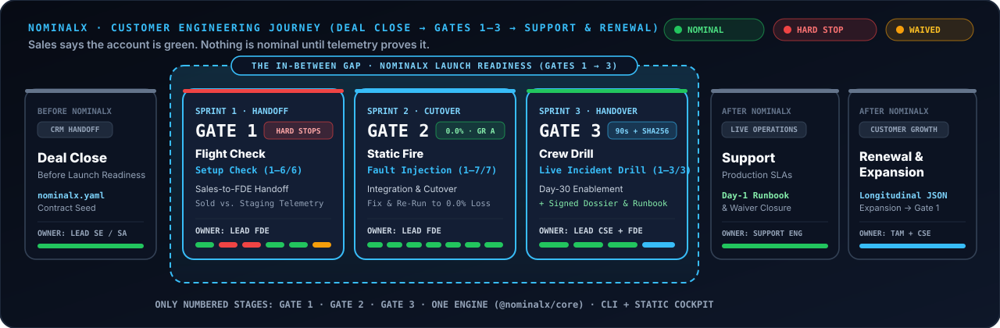

# NominalX — Field Guide & Executable Flight-Readiness System

> ***"Sales says the account is green. Nothing is nominal until telemetry proves it."***



**Live Mission Control Cockpit (Vercel, auto-deployed from `main`):** [https://nominalx.vercel.app](https://nominalx.vercel.app)

---

## An Open Guide, Ideas & Inspiration for Customer-Facing Engineering Teams

NominalX is an open field guide, working set of ideas, and executable reference architecture built engineer-to-engineer for technical products deployed into technical customer environments. Fork it, adapt its sprint contracts, or borrow its Hard Stop and reporting patterns to replace 90-row launch spreadsheets and Day-30 slide decks with deterministic telemetry.

NominalX is the result of sitting down with busy minds who run strategic enterprise deployments in the real world. It is the simplest way to get a real glimpse into their experience, how they think, and the critical details they normally keep in their heads or try to wrangle inside Google Sheets, Monday.com, or Linear. Complex? Detailed? Verbose? Yes — because real strategic deployments are, and this reflects that reality instead of hiding it behind a green slide.

**Written explicitly for:**
- **Customer-Facing Engineers:** **Sales Engineers**, **Solutions Engineers (SEs) / Solutions Architects (SAs)**, **Forward-Deployed Engineers (FDEs) / Implementation Engineers**, **Customer Success Engineers (CSEs)**, **Technical Account Managers (TAMs)**, and **Support Engineers**.
- **Customer Engineers:** **Customer Backend Engineers**, **Customer Platform / Infrastructure Engineers**, **Customer Security Engineers**, and **Customer On-Call SREs**.

### Why Stages 2 → 4 (*The Unverified Gap*)

Most customer software lives at the two edges of the lifecycle: pre-sales CRM at **Stage 1: Deal Close**, or reactive ticketing at **Stage 5: Support**. Almost nothing to be proud of, no proven methodology, and no executable tooling sits in **Stages 2 to 4** — where signed technical commitments actually turn into resilient production systems:

1. **Stage 2: Sales-to-FDE Handoff · Gate 1 (`1 of 3`): `FLIGHT CHECK`** — Diffs **What Sales Sold** against **What Exists in Customer Staging** across 6 parallel telemetry stations (`1 of 6`–`6 of 6`) with **Non-Waivable Hard Stops** on `AUTH / SSO` and `RESIDENCY`.
2. **Stage 3: Integration & Cutover · Gate 2 (`2 of 3`): `STATIC FIRE`** — Before live traffic hits, runs **7 realistic failure scenarios** (`1 of 7`–`7 of 7`) against staging — duplicate webhooks, out-of-order events, rate-limit bursts, 30-second timeouts, secret rotation, unexpected JSON fields, and clock drift — fixes the customer's integration where it breaks, and re-runs until zero records are lost or corrupted (**`0.0%` corruption, Grade `A`**).
3. **Stage 4: Day-30 Enablement & Handover · Gate 3 (`3 of 3`): `CREW DRILL` + Handover Sprint** — Runs **3 live 90-second Day-30 alarms** (`1 of 3`–`3 of 3`) where on-call engineers apply real configuration fixes (zero multiple-choice quizzes), then generates a **tamper-evident (SHA-256 signed) `NOMINAL` Dossier** recording every passed check, active waiver, failure-test grade, and drill time — paired with a **Day-1 Customer Runbook** tailored to the customer's exact stack, endpoints, and alert channels for **Stage 5: Support**.

---

## Master Lifecycle & Sprint Governance Table (Stages 1 → 6)

Every stage is executed as a **time-boxed engineering sprint** with **one Single Accountable Owner**, paired vendor + customer engineers, connected integrations, strict scope boundaries, and telemetry-backed Definition of Done.

| Stage | Goal | Single Accountable Owner | Vendor & Customer Engineers | Connected Integrations | Strict Scope Guardrails (In / Out / Hard Stops) | Reporting & Definition of Done |
|---|---|---|---|---|---|---|
| **Stage 1: Deal Close** *(Pre-Gap Contract Seed)* | Codify signed technical promises into a schema-valid `nominalx.yaml`. | **Lead Solutions Engineer (SE / SA)** | **Vendor:** Sales Eng, SE/SA, Lead FDE (read-in)<br>**Customer:** Eng Lead, Security Eng | CRM Handoff (`nominalx.yaml`), Jira/Linear | **In:** SSO, residency, HMAC, RPS, P1, RTO targets.<br>**Out:** Commercial pricing, unverified verbal promises.<br>**Hard Stop:** Schema-valid `nominalx.yaml` v1.0 required before Gate 1. | Committed `nominalx.yaml` passing `NominalXConfigSchema` with named engineering owners. |
| **Stage 2: Sales-to-FDE Handoff**<br>**Gate 1 (`1 of 3`): `FLIGHT CHECK`** *(Sprint 1)* | Diff **Sold Contract** vs. **Live Staging Telemetry** across 6 parallel stations (`1 of 6`–`6 of 6`). | **Lead Forward-Deployed Engineer (FDE)** | **Vendor:** Lead FDE, SE/SA, Sales Eng, Lead CSE, Support Eng, TAM<br>**Customer:** Platform/Infra, Security, Backend, On-Call SRE | Okta/Entra SSO, AWS/GCP Residency, HMAC Gateway, API Quota Edge, PagerDuty/Slack P1, Terraform/ArgoCD Rollback, Jira/Linear | **In:** Live HTTP/header/HMAC probes, strict Sold vs. Observed diffs.<br>**Out:** Waiving Hard Stops, 50k RPS laptop load tests, spreadsheet sign-offs.<br>**Hard Stops:** **`AUTH / SSO` (`1 of 6`) & `RESIDENCY` (`2 of 6`) are Non-Waivable.** Operational stations (`3–6 of 6`) allow max **2 active waivers ≤ 30d**. | `flight-check.json`, `exec` / `ops` / `waivers` reports; **0 `NO-GO`** stations; both Hard Stops `NOMINAL`. |
| **Stage 3: Integration & Cutover**<br>**Gate 2 (`2 of 3`): `STATIC FIRE`** *(Sprint 2)* | Run **7 realistic failure scenarios** (`1 of 7`–`7 of 7`) against staging, fix where it breaks, and re-run until zero records are lost or corrupted (`0.0%`). | **Lead Forward-Deployed Engineer (FDE)** | **Vendor:** Lead FDE, TAM<br>**Customer:** Backend, Platform/Infra, Security Engineers | HMAC Webhook Gateway, Rate-Limit Gateway, Release Automation | **In:** 7 automated failure scenarios, live config diffs, before/after test history.<br>**Out:** Untested prod deploys, LLM-guessed grades, multi-hour soak tests.<br>**Hard Stop:** Any corruption `> 0.0%` locks Gate 2 in `NO-GO` (exit `1`). | `static-fire.json` with **`0.0%` corruption (`Grade A · NOMINAL`)**, 7/7 scenarios passed, before/after delta log. |
| **Stage 4: Day-30 Enablement & Handover**<br>**Gate 3 (`3 of 3`): `CREW DRILL` + Handover Sprint** *(Sprint 3)* | Stabilize **3 live 90s Day-30 alarms** (`1 of 3`–`3 of 3`), then generate a tamper-evident (SHA-256 signed) launch dossier & stack-tailored Day-1 Runbook. | **Lead Customer Success Engineer (CSE)** *(Crew Drill)*<br>**Lead FDE** *(Handover Sign-Off)* | **Vendor:** Lead CSE, Lead FDE, Support Eng, TAM<br>**Customer:** On-Call SRE, Backend, Security, Customer Eng Lead | Rate-Limit Edge, Okta/Entra SSO, PagerDuty/Slack P1, Jira/Linear | **In:** Live 90s alarm config fixes, SHA-256 signed launch dossier, tailored Day-1 Runbook.<br>**Out:** Slide-deck trainings, multiple-choice quizzes, unsigned FDE roll-offs.<br>**Hard Stop:** Zero unstabilized Crew Drill alarms allowed prior to FDE roll-off. | `crew-drill.json` (3/3 stabilized with split times) + tamper-evident Signed `NOMINAL` Dossier (`.md`, `.json`, Slack) + Day-1 Runbook. |
| **Stage 5: Support** *(Post-Gap Operations)* | Operate SLAs from verified Day-1 baselines and close every Operational Waiver before expiry. | **Assigned Lead Support Engineer** | **Vendor:** Support Engineers, TAM, CSE<br>**Customer:** On-Call SREs, Backend/Platform Engineers | PagerDuty/Slack P1, Jira/Linear, Rollback Automation | **In:** Day-1 Runbook triage, 1-command `nominalx check` drift checks, waiver closure.<br>**Out:** Re-discovering Sales promises during P1s, silent waiver extensions.<br>**Hard Stop:** Any expired waiver (`today > expires_at`) immediately flags `NO-GO`. | Active Waiver Aging Register closed to `0` active waivers via live `NOMINAL` re-probe. |
| **Stage 6: Renewal & Expansion** *(Post-Gap Growth)* | Anchor renewal on longitudinal telemetry and seed expansion workloads into Stage 1 → Gate 1. | **Technical Account Manager (TAM)** | **Vendor:** TAM, Lead CSE, Sales Engineer<br>**Customer:** Customer Engineering, Platform & Security Leads | CRM Handoff (`nominalx.yaml`), Jira/Linear | **In:** Quarterly JSON dossier diffs, zero-waiver discipline, new region/RPS seeding.<br>**Out:** Qualitative health scores without telemetry, bypassing Gate 1 Hard Stops.<br>**Hard Stop:** New geographic regions require a fresh Gate 1 `RESIDENCY` pass. | Executive Readiness Report (`exec`) + fresh `nominalx.yaml` for expansion scope. |

---

## Sub-Stage Breakdown Across The Three Gates

### Stage 2 · Gate 1 (`1 of 3`): `FLIGHT CHECK` (`1 of 6` → `6 of 6`)

| Sub-Stage | Station | Policy Class | Accountable Owner | Definition of Done |
|---|---|---|---|---|
| **1 of 6** | `AUTH / SSO` | **HARD STOP (Non-Waivable)** | Lead FDE | Live IdP protocol matches contract, MFA enforced, cert TTL `≥ 30d`, unsigned assertions rejected. |
| **2 of 6** | `RESIDENCY` | **HARD STOP (Non-Waivable)** | Lead FDE | `100%` of `X-Served-Region`, storage buckets, and egress hops stay inside contracted region allowlist. |
| **3 of 6** | `WEBHOOKS` | Operational Waiver Eligible | Lead FDE | Unsigned/tampered payloads rejected (`401`/`403`), valid HMAC accepted, dual-key `[v1, v2]` rotation ready. |
| **4 of 6** | `QUOTA / RATE` | Operational Waiver Eligible | Lead SE / SA | Provisioned RPS `≥` sold contract and `429` responses emit valid numeric `Retry-After` headers. |
| **5 of 6** | `ALERTING` | Operational Waiver Eligible | Lead CSE | Synthetic P1 probe (`X-NominalX-Probe: true`) acknowledged (`2xx`) within SLA on active channel. |
| **6 of 6** | `ROLLBACK` | Operational Waiver Eligible | Lead FDE | Versioned artifact rollback dry-run passes within contracted max RTO with zero data loss. |

### Stage 3 · Gate 2 (`2 of 3`): `STATIC FIRE` (`1 of 7` → `7 of 7`)

| Sub-Stage | Failure Scenario | Failure Mode Caught | Definition of Done (`0.0%` Corruption) |
|---|---|---|---|
| **1 of 7** | Duplicate webhook delivery | Double-writes / duplicate ledger mutations | Identical `event_id` replays mutate state once (`200`/`204`/`409`). |
| **2 of 7** | Out-of-order events (`canceled` before `created`) | Zombie record resurrection | Monotonic version / terminal-state guard preserves `canceled`. |
| **3 of 7** | 429 rate-limit burst | Tight-loop retry storms & silent drops | Honors `Retry-After` with exponential backoff + jitter. |
| **4 of 7** | 30-second upstream timeout | Worker pool exhaustion & `502`/`504` cascade | Clean deadline abort + async retry/DLQ handoff. |
| **5 of 7** | Dual HMAC secret rotation | 100% drop during routine secret rotation | Accepts valid `v1` + `v2` signatures; rejects forged payloads. |
| **6 of 7** | Additive / unknown JSON fields | Strict-schema `400`/`422`/`500` crashes | Tolerant reader ignores unknown top-level & nested keys. |
| **7 of 7** | 5-minute clock skew | False drops on clock drift or replay exposure | Accepts valid `±5m` probes; rejects stale `-15m` replay (`401`). |

### Stage 4 · Gate 3 (`3 of 3`): `CREW DRILL` (`1 of 3` → `3 of 3`)

| Sub-Stage | Live Day-30 Alarm (`90s` Clock) | Accountable Owner | Real Config Remediation Verified (Zero Quizzes) |
|---|---|---|---|
| **1 of 3** | Runaway ingestion storm spiking quota/spend | Lead CSE | Isolate offending `source_key`, apply per-tenant RPS cap + DLQ overflow, hold green SLA for 3 consecutive ticks. |
| **2 of 3** | SSO certificate expiring within 24 hours | Lead CSE | Promote staged next X.509 fingerprint in dual-cert grace mode; verify live SSO handshake returns `200 NOMINAL` (`TTL > 365d`). |
| **3 of 3** | P1 alerts routing to a dead/archived channel | Lead CSE | Rebind P1 route to verified active ops channel; confirm live synthetic `X-NominalX-Probe` ping returns `200 OK`. |

---

## Executive & Operational Reporting Engine

One deterministic reporting engine (`packages/core/src/reporting.ts` & `packages/core/src/dossier.ts`) generates identical **Markdown (`.md`)**, **JSON (`.json`)**, and **Slack (`mrkdwn`)** outputs in both the CLI and the static web cockpit:

- **Executive Readiness Report (`nominalx report --type exec`)**: Master Launch Verdict, 6-stage lifecycle table, Hard Stop compliance attestation, Gate 1–3 telemetry rollup, waiver exposure, scope guardrails, and SHA-256 verification digest.
- **Operational Sprint & Integrations Digest (`nominalx report --type ops`)**: Active stage & single baton owner, live Integration Health Matrix, non-nominal station/scenario blockers with failing wire lines, and exact next CLI commands.
- **Active Waiver Aging Register (`nominalx report --type waivers`)**: Non-waivable Hard Stop attestation (`AUTH / SSO`, `RESIDENCY`), `2`-waiver cap utilization, aging bands (`HEALTHY` / `WARNING_14D` / `CRITICAL_7D` / `EXPIRED`), and Stage 5 Support drift command.
- **Signed `NOMINAL` Dossier & Tailored Day-1 Runbook (`nominalx dossier`)**: Tamper-evident (SHA-256 signed) launch readiness dossier recording every passed check, active waiver, failure-test grade, and drill time — co-signed by Lead FDE, Lead CSE, and Customer Engineering Lead and paired with a Day-1 Runbook tailored to the customer's exact stack, endpoints, and alert channels.

---

## Real CLI Run & Generated Deliverables (*Meridian FinTech*)

Everything below was produced by running the real `nominalx` CLI locally against `nominalx demo-target --port 4040 --preset meridian` with zero mocks and zero LLM calls. Full raw outputs are committed in [`docs/examples/meridian-fintech/`](./docs/examples/meridian-fintech/).

### 1. Gate 1 (`1 of 3`): Flight Check — Failing Hard Stop Diff → Live Patch → `CONDITIONAL_GO`


### 2. Gate 2 (`2 of 3`): Static Fire — `37.1%` Grade `F` → Live Handler Patch → `0.0%` Grade `A` `NOMINAL`


### 3. Executive Brief, Operational Slack Digest & Signed `NOMINAL` Dossier


### Real Output Excerpts (Direct Links to Full Files)

- **Full CLI Run Transcript:** [`docs/examples/meridian-fintech/cli-run-transcript.txt`](./docs/examples/meridian-fintech/cli-run-transcript.txt)
- **Executive Readiness Brief:** [`docs/examples/meridian-fintech/executive-readiness-brief.md`](./docs/examples/meridian-fintech/executive-readiness-brief.md)
- **Operational Sprint Digest (Slack Paste):** [`docs/examples/meridian-fintech/operational-sprint-digest-slack.txt`](./docs/examples/meridian-fintech/operational-sprint-digest-slack.txt)
- **Waiver Aging Register:** [`docs/examples/meridian-fintech/waiver-aging-register.md`](./docs/examples/meridian-fintech/waiver-aging-register.md)
- **Signed `NOMINAL` Dossier & Day-1 Runbook:** [`docs/examples/meridian-fintech/signed-nominal-dossier.md`](./docs/examples/meridian-fintech/signed-nominal-dossier.md)

<details>
<summary><strong>Preview: Executive Readiness Brief excerpt</strong> (<code>nominalx report --type exec --format md</code>)</summary>

```markdown
# Executive Readiness Report — Meridian FinTech

> **Master Verdict:** `CONDITIONAL_GO` | **Accountable Owner:** `Lead FDE + Lead CSE` | **Target Go-Live:** `2026-12-01`

## Executive Decision

CONDITIONAL GO — Proceed with Signed NOMINAL WITH WAIVERS Dossier; track 1 active Operational Waiver(s) to closure before 2026-12-15.

| Gate | Metric | Result |
|---|---|---|
| Gate 1 (1 of 3): Flight Check | Station Verdict | `CONDITIONAL_GO` (5 NOMINAL, 1 WAIVED, 0 NO-GO) |
| Hard Stops (Non-Waivable) | AUTH / SSO & RESIDENCY | AUTH `NOMINAL` · RESIDENCY `NOMINAL` (Violations: 0) |
| Gate 2 (2 of 3): Static Fire | Resilience Grade & Corruption | Grade `A` · 0.0% (7/7) · Fire #1: 37.1% (Grade F) -> Fire #2: 0.0% (Grade A) |
| Gate 3 (3 of 3): Crew Drill | Day-30 Alarm Stabilization | 3/3 stabilized (0 overtime, total 59.6s) |
| Operational Waiver Exposure | Active Cap & Nearest Expiry | `1 / 2` · Nearest expiry: `2026-12-15` (24d left) |
```

</details>

<details>
<summary><strong>Preview: Operational Sprint Digest (Slack paste)</strong> (<code>nominalx report --type ops --format slack</code>)</summary>

```text
*Operational Sprint & Blocker Digest — Meridian FinTech*
*Stage:* Stage 4: Day-30 Enablement & Handover · *Gate:* Handover Sprint: Signed NOMINAL Dossier & Day-1 Runbook · *Owner:* `Lead FDE + Lead CSE` · *Verdict:* `CONDITIONAL_GO`

*Gate 1 Non-Nominal Stations (1):*
> • 6 of 6 `ROLLBACK` [HOLD_WAIVED] (OPERATIONAL WAIVER) — Cut automated blue/green rollback RTO from 11m to <= 5m, or document a bounded Operational Waiver with verified manual failover.
*Digest:* `sha256:400bd5670f61b11b1471de95f4b3faccacb8cee3ed3a6a65ce9e119a258bf191`
```

</details>

<details>
<summary><strong>Preview: Waiver Aging Register excerpt</strong> (<code>nominalx report --type waivers --format md</code>)</summary>

```markdown
# Active Waiver Aging Register — Meridian FinTech

> **Reference Date:** `2026-11-21` | **Active Cap Utilization:** `1 / 2` | **Max Window:** `<= 30d` | **Hard Stop Violations:** `0`

| Station | Owner | Ticket | Expires At | Days Remaining | Aging Band | Reason | Rollback Plan |
|---|---|---|---|---|---|---|---|
| `ROLLBACK` | `maya.chen@meridian.example` | `MER-4182` | `2026-12-15` | 24d | `HEALTHY` | Automated blue/green ArgoCD cutover ships Sprint 24; verified manual DNS failover active. | Run scripts/dns-failover.sh --cluster eu-central-v18 to revert traffic within 9 minutes. |
```

</details>

<details>
<summary><strong>Preview: Signed NOMINAL Dossier &amp; Day-1 Runbook excerpt</strong> (<code>nominalx dossier --format md</code>)</summary>

```markdown
# NominalX Signed Flight Readiness Dossier — Meridian FinTech

> **Verdict:** `NOMINAL WITH WAIVERS` | **Master Launch State:** `CONDITIONAL_GO` | **Verification Digest:** `sha256:8f640d3389acf9e58f9c14f9426aec14aee6eaaf95260e0e7c45294db6b193c1`

## Stack-Tailored Day-1 Customer Runbook (Into Stage 5: Support)

- **Stack:** Cloud `aws` · IdP `okta-saml` · Alerting `pagerduty+slack` · Runtime `node-express`
- **Verified Baselines:** Auth `SAML2` · Regions `[eu-central-1, eu-west-1]` · Quota `50,000 RPS` · P1 `#eng-meridian-p1` · Max RTO `5m`

### 1. Support Day-1 Drift Detection & Contract Re-Verification
nominalx check ./nominalx.yaml
nominalx report --config ./nominalx.yaml --type waivers --format md

### 2. Zero-Downtime Dual-HMAC Key Rotation (node-express)
export NOMINALX_WEBHOOK_SECRET_NEXT="<new_staged_secret>"
nominalx fire --url http://127.0.0.1:4040/webhooks/events --config ./nominalx.yaml
```

</details>

---

## Offline CLI Quickstart (Zero External Infrastructure)

Run the full deterministic lifecycle locally against the built-in buggy staging target (`meridian`, `kestrel`, `vanguard`, or `helios`):

```bash
pnpm install && pnpm build

# Terminal 1: Start a real local staging target reproducing all 6 Gate 1 stations & 7 Gate 2 scenarios
pnpm nominalx demo-target --port 4040 --preset meridian

# Terminal 2: Stage 2 / Gate 1 (1 of 3) — Flight Check (fails on RESIDENCY Hard Stop & WEBHOOKS)
pnpm nominalx check examples/meridian-fintech/nominalx.yaml --out flight-check.json

# Patch staging residency & dual-HMAC webhook verification live, then re-verify
pnpm nominalx demo-patch --port 4040 --fix residency,webhooks
pnpm nominalx check examples/meridian-fintech/nominalx.yaml --out flight-check.json

# Stage 3 / Gate 2 (2 of 3) — Static Fire (37.1% Grade F -> live patch -> 0.0% Grade A)
pnpm nominalx fire --url http://127.0.0.1:4040/webhooks/events --config examples/meridian-fintech/nominalx.yaml --out static-fire.json
pnpm nominalx demo-patch --port 4040 --fix idempotency,ordering,dual-hmac
pnpm nominalx fire --url http://127.0.0.1:4040/webhooks/events --config examples/meridian-fintech/nominalx.yaml --out static-fire.json

# Executive & Operational Reports (md | json | slack)
pnpm nominalx report --config examples/meridian-fintech/nominalx.yaml --type exec --format md --flight-check flight-check.json --static-fire static-fire.json
pnpm nominalx report --config examples/meridian-fintech/nominalx.yaml --type ops --format slack --flight-check flight-check.json --static-fire static-fire.json
pnpm nominalx report --config examples/meridian-fintech/nominalx.yaml --type waivers --format md --flight-check flight-check.json

# Handover Sprint — Tamper-Evident Signed NOMINAL Dossier & Tailored Day-1 Runbook
pnpm nominalx dossier --config examples/meridian-fintech/nominalx.yaml --flight-check flight-check.json --static-fire static-fire.json --format md --out nominalx-dossier-meridian.md
pnpm nominalx dossier --config examples/meridian-fintech/nominalx.yaml --flight-check flight-check.json --static-fire static-fire.json --format slack
```

### Run & Deploy the Static Web Mission Control

The live cockpit is hosted on **Vercel** at **[https://nominalx.vercel.app](https://nominalx.vercel.app)** and auto-deploys from `main`. Public forks can also enable the included GitHub Pages workflow (`.github/workflows/pages.yml`) with zero backend infrastructure.

```bash
pnpm --filter @nominalx/web dev      # Local dev cockpit (Dark default + 1-click Light toggle)
pnpm --filter @nominalx/web build    # Zero-backend static bundle in packages/web/dist/
pnpm --filter @nominalx/web preview  # Preview production static bundle
```

---

## How to Customize Stations, Chaos Vectors, and Day-30 Alarms

NominalX is designed so every customer deployment stays **zero-code** in YAML, while engineering teams forking the repo for their own product can add, remove, or swap checks in one clean pass across `@nominalx/core` and `nominalx`.

### A. Per-Customer Config (Zero Code via `nominalx.yaml`)

For each new customer account, copy one of the 4 templates in [`examples/`](./examples/) and edit only the contract seed — zero code changes required:

- **Contract Promises (`sold_contract.*`):** Set contracted IdP protocol & `min_cert_ttl_days`, allowed cloud regions & `strict_egress`, webhook signing & `max_clock_skew_seconds`, `guaranteed_rps`, `p1_channel` & `max_ack_ms`, and `max_rto_minutes`.
- **Staging Endpoints & Secret Env Vars (`environment.*`):** Point `base_url` and `endpoints.*` at the customer's real staging routes, and reference signing secrets via `env:VAR_NAME` so credentials never touch Git.
- **Time-Boxed Operational Waivers (`waivers[]`):** Add bounded waivers (max **2 active**, `≤ 30` days, named owner, concrete rollback plan, ticket ID) for operational stations (`WEBHOOKS`, `QUOTA / RATE`, `ALERTING`, `ROLLBACK`). Attempting to waive `AUTH / SSO` or `RESIDENCY` is automatically rejected as `NO-GO`.

### B. Adapting Stations, Chaos Vectors, and Day-30 Alarms for Your Product

When adapting NominalX to your own product's failure modes (for example, adding a database replication lag check, an mTLS egress Hard Stop, or a custom Day-30 incident drill), update the shared types and evaluators once in `packages/core/src/` and wire the live HTTP probe in `packages/cli/src/`:

| What You Want to Change | Core Engine Files (`packages/core/src/`) | Live CLI Runner (`packages/cli/src/`) |
|---|---|---|
| **Add / swap a Gate 1 station** (or mark a new Hard Stop) | `types.ts` (`StationCode`, `StationLabel`, `ObservedEnvironmentTelemetry`), `lifecycle.ts` (`GATE1_SUB_STAGES`), `gate1.ts` (`HARD_STOP_STATIONS`, `evaluateFlightCheck`) | `probes.ts` (`probeEnvironmentTelemetry`) |
| **Add / swap a Gate 2 failure scenario** | `types.ts` (`ChaosVectorId`), `lifecycle.ts` (`GATE2_SUB_STAGES`), `gate2.ts` (`CHAOS_VECTOR_ORDER`, `scoreStaticFire`) | `chaos.ts` (`runLiveStaticFire`) |
| **Add / swap a Gate 3 Day-30 alarm drill** | `types.ts` (`CrewAlarmId`), `lifecycle.ts` (`GATE3_SUB_STAGES`), `gate3.ts` (`CREW_DRILL_ALARM_ORDER`, `applyCrewRemediation`) | *(Web cockpit + preset specs in `packages/core/src/presets.ts`)* |

**Concrete example — promoting a new Hard Stop station (`MTLS_EGRESS`) in Gate 1:**

```ts
// 1. packages/core/src/types.ts — add the station code & label
export type StationCode =
  | "AUTH_SSO" | "RESIDENCY" | "MTLS_EGRESS"
  | "WEBHOOKS" | "QUOTA_RATE" | "ALERTING" | "ROLLBACK";

// 2. packages/core/src/gate1.ts — enforce as a Non-Waivable Hard Stop
export const HARD_STOP_STATIONS: readonly StationCode[] = [
  "AUTH_SSO",
  "RESIDENCY",
  "MTLS_EGRESS",
];

// 3. packages/cli/src/probes.ts — probe the customer's staging endpoint live
const mtlsRes = await fetchJsonProbe(joinUrl(baseUrl, "/health/mtls"), { method: "GET" }, timeoutMs);
// Pass the observed fields into evaluateFlightCheck(); the CLI, web cockpit,
// Executive Report, Waiver Register, and SHA-256 Dossier automatically inherit it.
```

---

## Monorepo Architecture

```text
nominalX/
├── docs/
│   ├── customer-journey.svg         # Stages 1 -> 6 & The Unverified Gap vector graphic
│   ├── assets/                      # Real high-DPI CLI terminal screenshots
│   └── examples/meridian-fintech/   # Real CLI transcript, Executive Brief, Slack Digest, Waiver Register & Signed Dossier
├── examples/                        # 4 pre-built enterprise nominalx.yaml contract seeds
│   ├── meridian-fintech/            # Payments · EU-Strict · Okta SAML · 50k RPS (default)
│   ├── kestrel-health/              # HIPAA Healthcare · Entra OIDC · Strict Timeouts
│   ├── vanguard-retail/             # Peak Commerce · FastAPI · 50k RPS Burst
│   └── helios-logistics/            # Global Supply Chain · Near-Launch · 1 Active Waiver
├── packages/
│   ├── core/                        # @nominalx/core — Zero-LLM browser+Node deterministic engine
│   ├── cli/                         # nominalx — Real HTTP/TLS/HMAC/failure-test CLI + demo-target
│   └── web/                         # @nominalx/web — Zero-backend static cockpit (Vercel + optional GitHub Pages)
├── .github/workflows/
│   ├── ci.yml                       # Typecheck, build, unit & E2E tests across all packages
│   └── pages.yml                    # Optional static deployment workflow for GitHub Pages forks
└── THESIS.md                        # Product thesis & architectural principles
```
